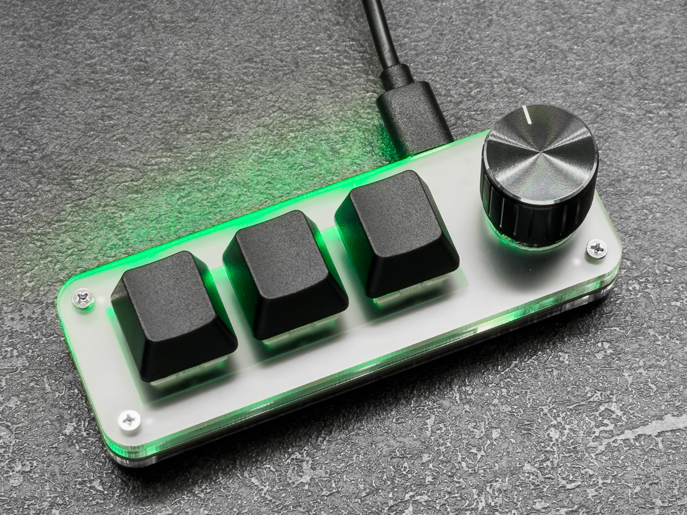
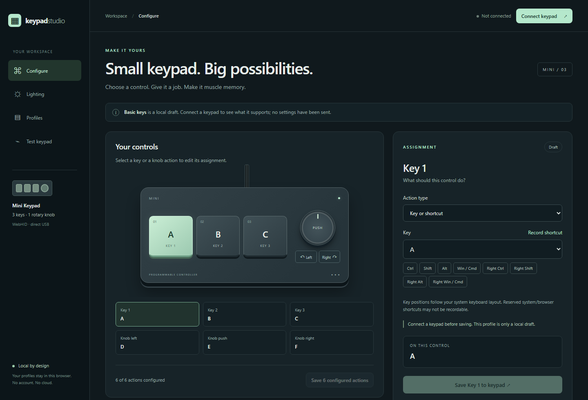

<h1 align="center">Keypad Studio</h1>

Configure keys, knob actions, lighting, and local profiles for the three-key keypad in your browser.

<a href="https://jonassvidras.github.io/keypad-studio/"><strong>Open Keypad Studio</strong></a>

| The keypad | Keypad Studio |
| :---: | :---: |
|  |  |

The tested keypad and its browser configurator. Click either image to enlarge.

## Get started

1. Open [Keypad Studio](https://jonassvidras.github.io/keypad-studio/) in desktop Chrome or Edge.
2. Plug in your three-key keypad and click **Connect keypad**. Choose it in the browser prompt if one appears.
3. Choose a key or knob action, then click its **Save** button. Open **Lighting** to choose an effect and save it separately.

Saved settings stay on the keypad when you close the page. The browser may connect directly next time if you already gave it permission.

## What works

| Firmware | Controls | Lighting |
| --- | --- | --- |
| Original | Plain keys; other actions are experimental | 3 built-in modes |
| [KeypadOpen v2](https://github.com/jonassvidras/keypad-flasher) | Keys, shortcuts, media, clicks, scrolling | 12 modes, brightness, 3 colors |

Studio detects the firmware after connecting. The original firmware works without modification. Studio is designed for the tested three-key, clickable-knob CH552G keypad; look-alike boards may differ. **Studio does not flash firmware.**

## Local profiles and device saves

Profiles stay in your browser. Connecting may read device settings, but it does not change them; only a **Save** button writes your changes. There is no account or cloud service. Export a profile if you want a portable copy; it is not a firmware backup.

Keypad Studio is open source under the [MIT License](LICENSE).

## Help improve it

This is a finished personal project, but issues and pull requests are welcome. [Report a problem](https://github.com/jonassvidras/keypad-studio/issues) with your keypad's board markings, firmware, browser, and steps to reproduce. Do not post chip UIDs, serial numbers, or logs containing personal paths.

Run locally instead

From this directory, run `python -m http.server 8765 --bind 127.0.0.1`, then open `http://127.0.0.1:8765/`. WebHID needs a [secure context](https://developer.mozilla.org/en-US/docs/Web/Security/Defenses/Secure_Contexts); localhost qualifies. The app needs a [WebHID-capable browser](https://developer.chrome.com/docs/capabilities/hid).

